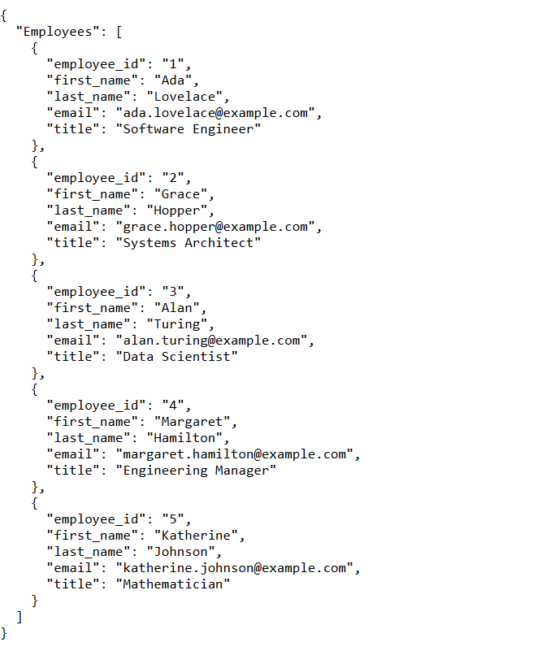

# Employee Service

A small Spring Boot REST service that manages employee data in memory. It supports retrieving all employees (`GET`) and adding a new employee (`POST`), and includes a unit test suite built with JUnit 5 and Mockito.

## Tech Stack

- Java 25
- Spring Boot 4.0.8 (`spring-boot-starter-webmvc`)
- Gradle (wrapper included)
- JUnit 5, Mockito, Spring MockMvc

## Project Structure

```
src/
├── main/java/com/example/restservice/
│   ├── RestServiceApplication.java   # Application entry point
│   ├── Employee.java                 # Employee model
│   ├── Employees.java                # Wrapper holding the list of employees
│   ├── EmployeeManager.java          # In-memory data store (4 seeded employees)
│   └── EmployeeController.java       # REST endpoints
└── test/java/com/example/restservice/
    ├── EmployeeControllerTest.java   # Web-layer tests (MockMvc + Mockito)
    └── EmployeeManagerTest.java      # Plain JUnit tests for the data store
```

## Getting Started

### Build

```bash
./gradlew build
```

### Run

```bash
./gradlew bootRun
```

The service starts on `http://localhost:8080`.

## API

### GET `/employees`

Returns all employees.

```bash
curl http://localhost:8080/employees
```

Response (`200 OK`):

```json
{
  "Employees": [
    {
      "employee_id": "1",
      "first_name": "Ada",
      "last_name": "Lovelace",
      "email": "ada.lovelace@example.com",
      "title": "Software Engineer"
    }
  ]
}
```

### POST `/employees`

Adds a new employee and returns it.

```bash
curl -X POST http://localhost:8080/employees \
  -H "Content-Type: application/json" \
  -d '{"employee_id":"5","first_name":"Jane","last_name":"Doe","email":"jane@example.com","title":"Analyst"}'
```

Response (`201 Created`):

```json
{
  "employee_id": "5",
  "first_name": "Jane",
  "last_name": "Doe",
  "email": "jane@example.com",
  "title": "Analyst"
}
```

Error responses:

| Case | Status |
|------|--------|
| Malformed JSON body | `400 Bad Request` |
| Non-JSON content type | `415 Unsupported Media Type` |

> Data is stored in memory only, so added employees are lost when the application restarts.

## Testing

```bash
./gradlew clean test
```

The HTML report is generated at `build/reports/tests/test/index.html`.

### What is covered

**`EmployeeControllerTest`** (MockMvc, with `EmployeeManager` mocked via Mockito)

- GET returns `200` with the expected JSON structure and field values
- GET with an empty list returns an empty array
- POST with valid JSON returns `201` and echoes the employee
- POST passes the correctly parsed employee to `EmployeeManager` (verified with `ArgumentCaptor`)
- POST with malformed JSON returns `400` and does not call the manager
- POST with the wrong content type returns `415` and does not call the manager

**`EmployeeManagerTest`** (plain JUnit)

- Starts with four seeded employees
- `addEmployee` increases the list size
- A newly added employee is retrievable at the end of the list
- Multiple additions are all retained

## Author

Hooman Vahdat — [github.com/hoomanv3xo](https://github.com/hoomanv3xo)
